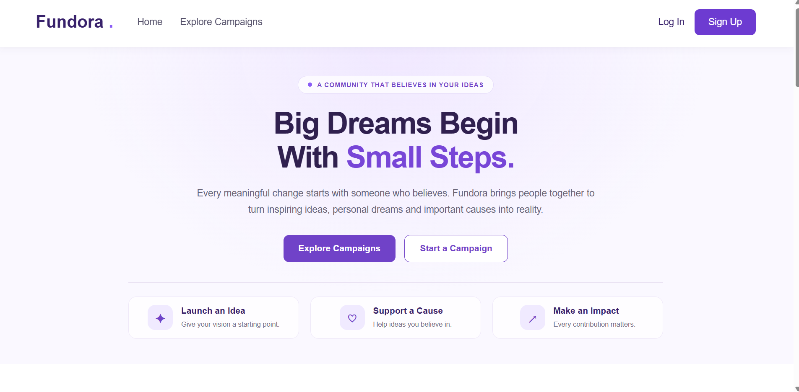
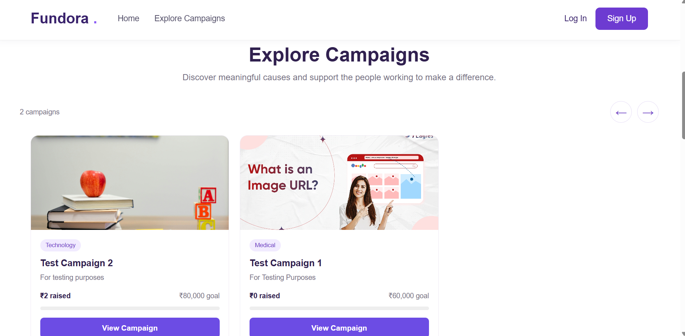
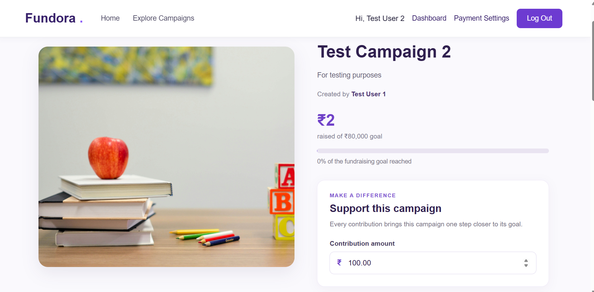
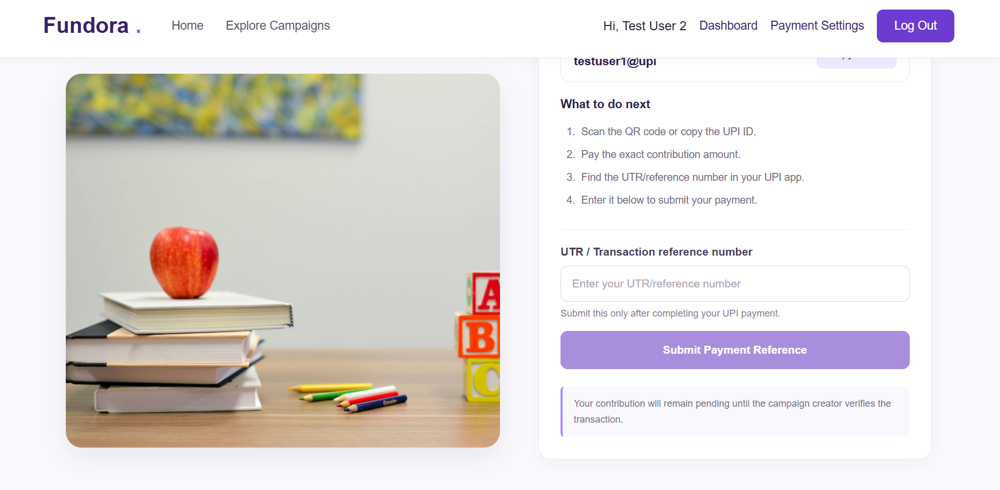
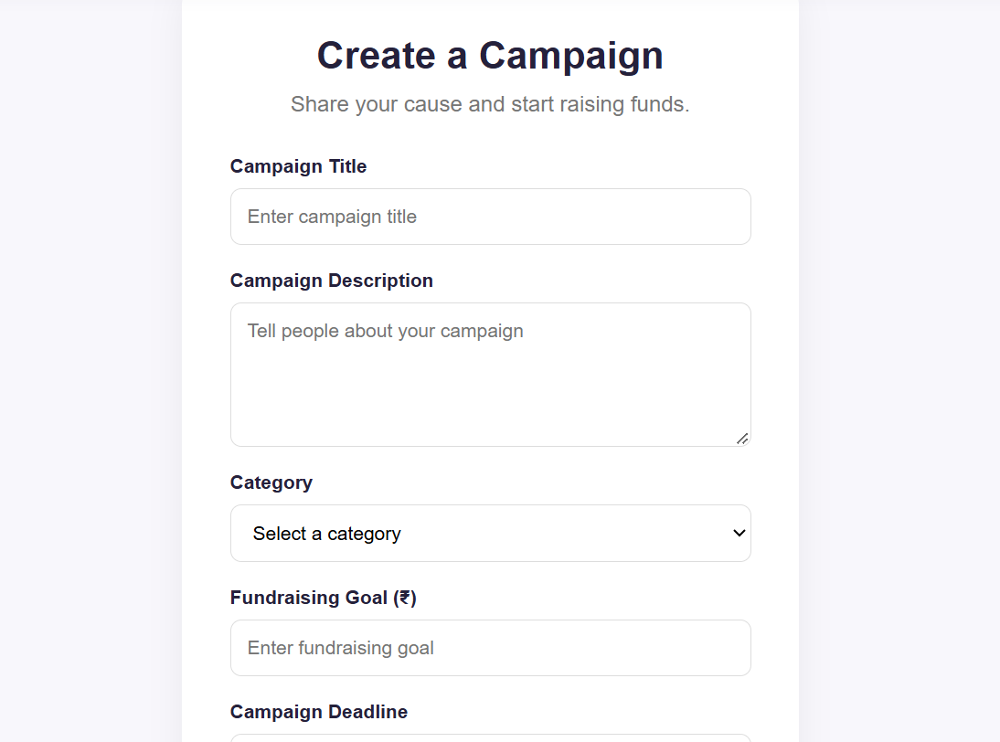
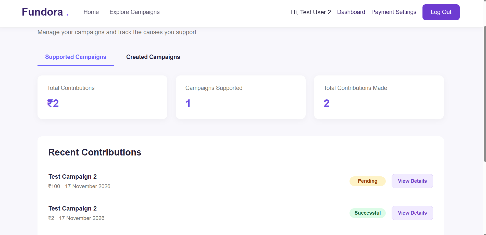
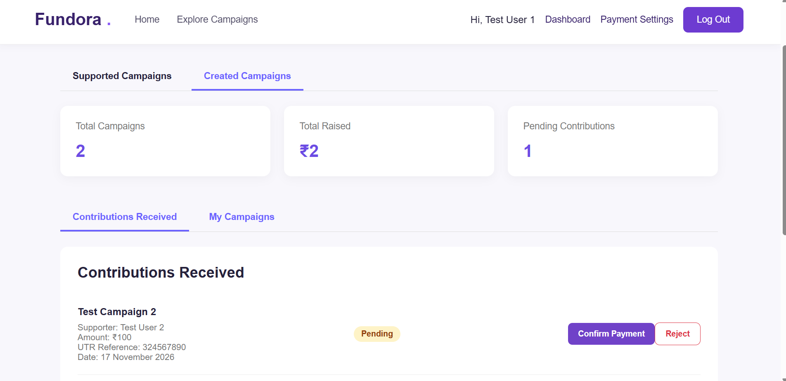
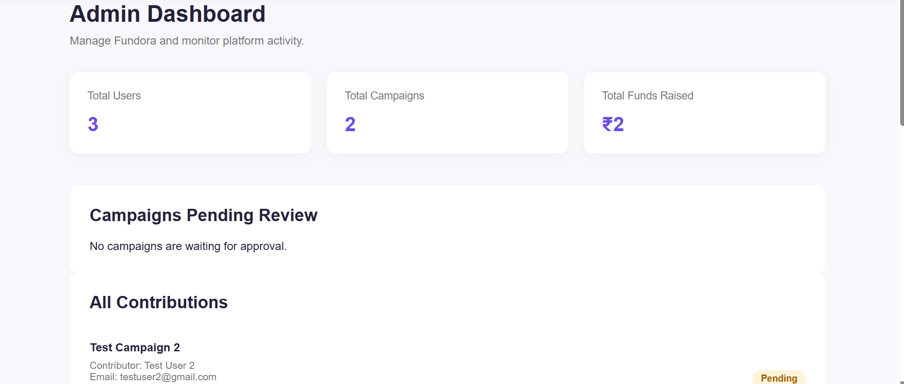

# Fundora - A Crowdfunding Platform

Fundora is a full-stack crowdfunding platform that brings ideas to life by connecting campaign creators with people who believe in their causes. Users can launch campaigns, discover initiatives, and contribute through a simple UPI-based system.

**Live Website:** https://fundora-chi.vercel.app/

**GitHub Repository:** https://github.com/snehachandra1108/Fundora

---


## Features

### User Features
- User registration and login.
- Create, edit, and manage fundraising campaigns.
- Explore publicly available, approved campaigns.
- Contribute to campaigns through UPI.
- Submit UTR/reference numbers to track contributions.
- View contributions made and contributions received.
- Manage UPI payment details to receive contributions.

### Campaign Management
- Create campaigns with funding goals and deadlines.
- Campaigns remain unpublished until approved by an admin.
- Editing an approved campaign automatically sends it for approval again.
- Pending and rejected campaigns can be managed by their creators.
- Approved campaigns cannot be deleted.
- Existing contributions and funds raised are preserved when a campaign is edited and submitted for review.

### Contribution Management
- UPI-based contribution workflow.
- UTR/reference number submission and duplicate UTR validation.
- Track contribution statuses and maintain contribution history.
- Campaign creators can view contributions received.
- Campaign funding totals stay synchronized with successful contributions.

### Admin Features
- Admin dashboard with platform statistics, including users, campaigns, and total funds raised.
- Review pending campaigns and approve or reject submissions.
- View registered users.
- View contribution records.

---

## Tech Stack

| Area | Technologies |
|---|---|
| Frontend | React, TypeScript, Vite |
| Routing | React Router |
| Backend | Node.js, Express.js, TypeScript |
| Database | PostgreSQL |
| API | REST APIs |
| Deployment | Vercel, Render, Neon PostgreSQL |
| Version Control | Git, GitHub |

---

## Project Structure

```text
Fundora/
├── backend/
│   └── src/
│       ├── admin/
│       ├── auth/
│       ├── campaigns/
│       ├── config/
│       ├── contributions/
│       ├── middleware/
│       ├── paymentSettings/
│       ├── types/
│       └── server.ts
│
├── frontend/
│   ├── public/
│   └── src/
│       ├── assets/
│       ├── components/
│       ├── config/
│       ├── context/
│       ├── data/
│       ├── types/
│       ├── App.tsx
│       ├── App.css
│       ├── index.css
│       └── main.tsx
│
└── README.md
```

---

## Installation and Setup

### Prerequisites
- Node.js and npm
- A PostgreSQL database (Neon or a local PostgreSQL instance)

### 1. Clone the Repository

```bash
git clone https://github.com/snehachandra1108/Fundora.git
cd Fundora
```

### 2. Set Up the Database

Create a PostgreSQL database for Fundora.

Run the database schema file to create the required tables:

```bash
psql -d your_database_name -f backend/database/schema.sql
```

### 3. Set Up the Backend

```bash
cd backend
npm install
```

Create a `.env` file inside the `backend` directory:

```env
DATABASE_URL=your_postgresql_connection_string
FRONTEND_URL=http://localhost:5173
NODE_ENV=development
PORT=5000
```

Start the backend:

```bash
npm run dev
```

### 4. Set Up the Frontend

Open a new terminal from the project root:

```bash
cd frontend
npm install
```

Create a `.env` file inside the `frontend` directory:

```env
VITE_API_URL=http://localhost:5000
```

Start the frontend:

```bash
npm run dev
```

The frontend will be available at `http://localhost:5173` and the backend at `http://localhost:5000`.

---

## Screenshots

<table>
  <tr>
    <td width="50%">
      
      <h3>Homepage</h3>
      <p>Landing page of Fundora.</p>
    </td>
    <td width="50%">
      
      <h3>Explore Campaigns</h3>
      <p>Browse publicly available campaigns.</p>
    </td>
  </tr>
  <tr>
    <td width="50%">
      
      <h3>Campaign Details</h3>
      <p>View campaign information and contribution options.</p>
    </td>
    <td width="50%">
      
      <h3>Payments</h3>
      <p>View UPI payment information.</p>
    </td>
  </tr>
  <tr>
    <td width="50%">
      
      <h3>Create Campaign</h3>
      <p>Create a new fundraising campaign.</p>
    </td>
    <td width="50%">
      
      <h3>Supported Campaigns</h3>
      <p>View campaigns you have contributed to.</p>
    </td>
  </tr>
  <tr>
    <td width="50%">
      
      <h3>Created Campaigns</h3>
      <p>Manage your campaigns and view contributions received.</p>
    </td>
    <td width="50%">
      
      <h3>Admin Dashboard</h3>
      <p>Monitor platform statistics and manage campaigns and contributions.</p>
    </td>
  </tr>
</table>

---

## Highlights

- Campaign approval workflow with automatic re-submission for review when approved campaigns are edited.
- UPI-based contribution tracking with unique UTR validation.
- Database consistency between successful contributions and campaign funding totals.
- Secure session-based authentication and role-based access control.
- Paginated contribution records for efficient data retrieval.

---

## Live Demo

- **Frontend:** https://fundora-chi.vercel.app/
- **Backend:** https://fundora-backend-2jqd.onrender.com

---

## Future Improvements

- Strengthen signup validation with proper email verification and password requirements.
- Integrate a secure payment gateway for automated payment processing.
- Introduce email notifications for account verification, campaign updates, and contribution status.
- Add campaign search, filtering, and sorting.
- Implement automated unit and integration testing.
- Introduce campaign analytics and visual funding insights.

